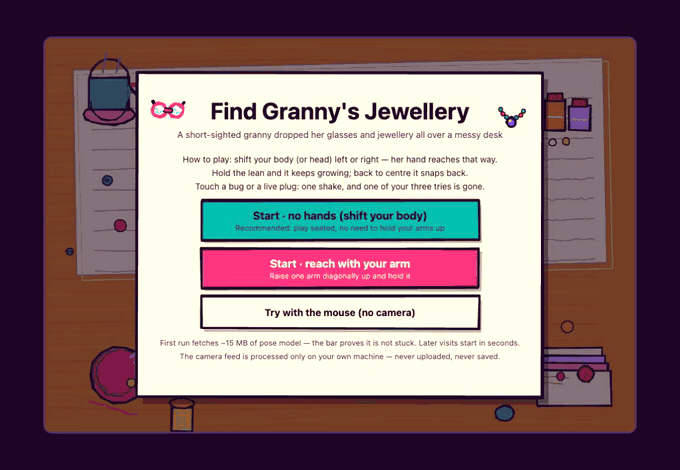
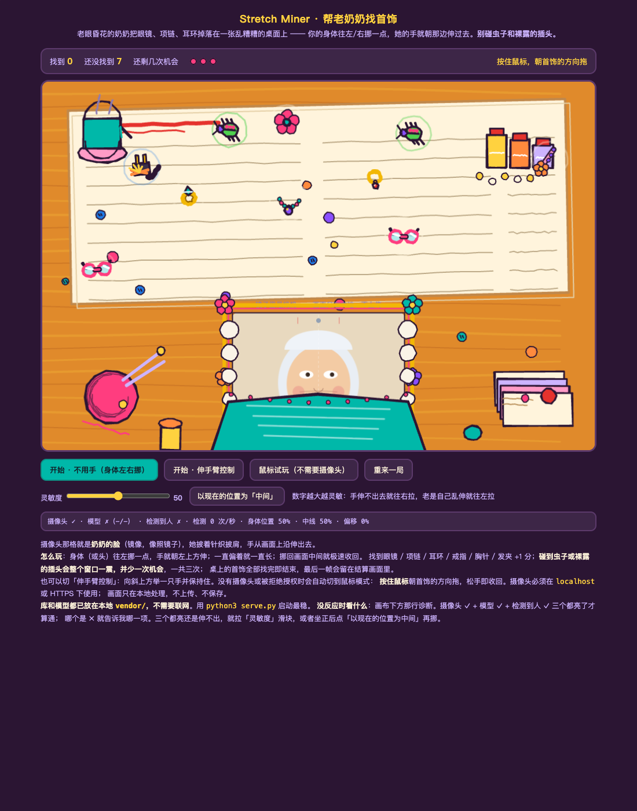
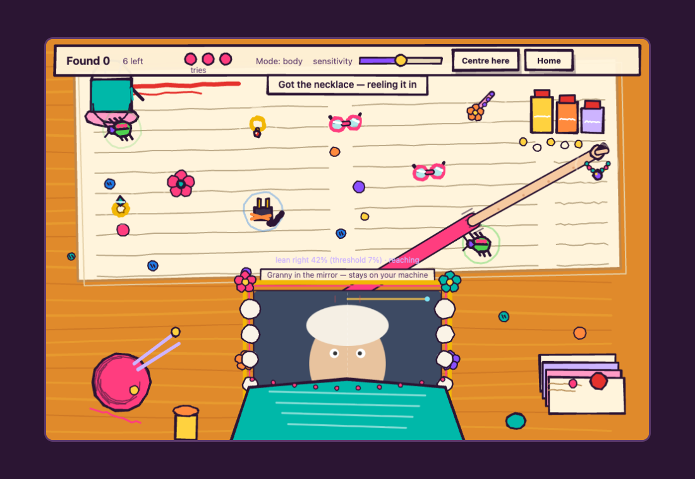
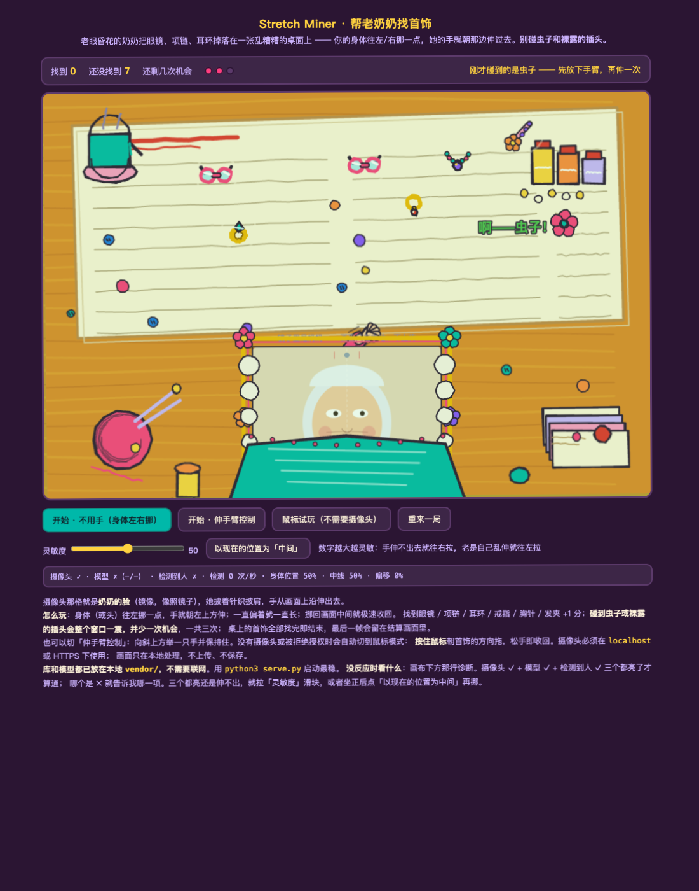
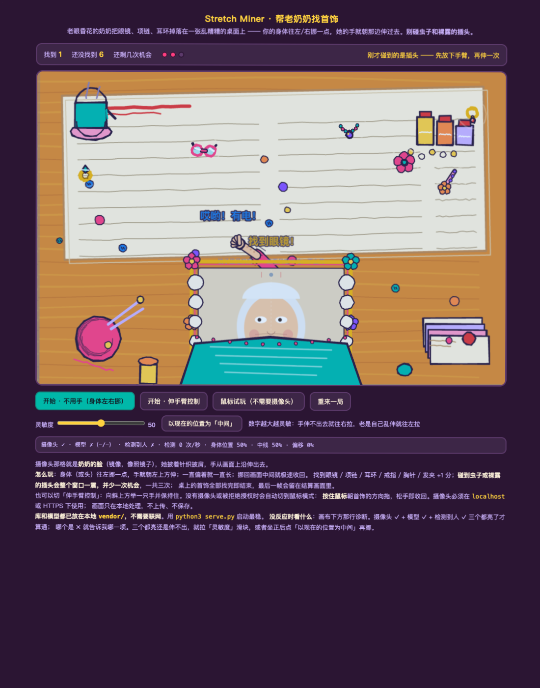
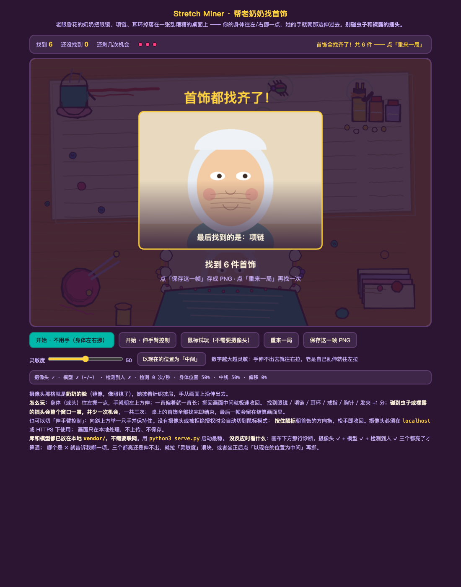
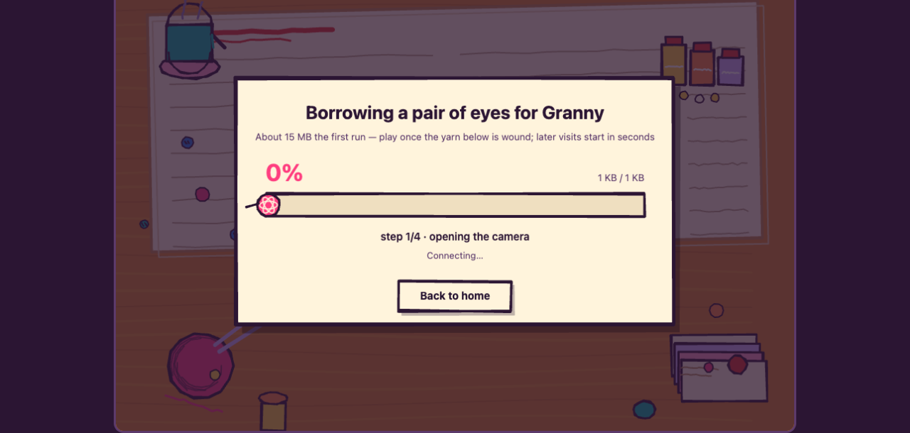

# Stretch Miner · Help Granny Find Her Jewellery

**Play online: https://ardenshi.github.io/stretch-miner/** (HTTPS, camera works, nothing to install)



SD5913 Assignment 3 (interactive experience). A short-sighted granny has dropped her
**glasses, necklace, earrings, ring, brooch and hairpin** on a hopelessly messy desk —
scattered among old newspapers, a teacup, medicine bottles, a ball of yarn, letters
and buttons. The camera feed is **Granny's face** (centred along the bottom edge of
the canvas, mirrored like a mirror), and her hand reaches out from its top edge.
**It is playable without hands**: shift your body (or head) a little to the left or
right and the hand reaches diagonally that way; keep leaning and it keeps growing;
return to the centre and it snaps back instantly.

Mixed into the desk are **bugs and bare plugs that are still live** — touch one and
the hand snaps back, **the whole browser window shakes** (canvas shake + a
`body.quake` CSS animation), and you lose one of three tries. Find every piece of
jewellery to finish; the result screen shows, front and centre, **the frozen camera
frame from the moment you caught the last piece**, which you can save as a PNG.

| A messy desk | Caught the necklace |
| --- | --- |
|  |  |

| Touched a bug: quip + one try fewer + whole-window shake | Touched a plug: electric-blue feedback |
| --- | --- |
|  |  |

The result screen — the frozen frame of the last catch in the middle:



> About the footage: the "camera panel" in `shots/demo.gif` shows a virtual face
> injected during automated testing. With a real webcam that slot is your own live
> feed. Full video: `shots/demo.mp4`.

- Target users: people who have been sitting too long and want to move a little;
  you only shift your body left and right — no need to hold your arms up, it works
  seated.
- Core loop: lean (input) → the hand grows along the lean direction (response) →
  you see the fingers close, hear the sound, a quip pops up / the window shakes
  (feedback) → decide how far to lean next time.
- Three controls: `head` (how far your nose/torso sits off centre — default,
  hands-free) · `arm` (MediaPipe reads the wrist-to-shoulder vector, for really
  reaching out) · `mouse` (press and drag, fallback).
- If the camera is denied or the model fails to load, the game switches to mouse
  mode automatically.
- Privacy: frames are only ever inferred locally — nothing is uploaded, nothing is
  stored; the frozen frame lives in memory until you press "Save this frame".

## The look

Marker-pen strokes + a high-saturation palette: every shape goes through a small
hand-drawn stroke toolkit (`ink` = one fill pass + two jittered stroke passes; the
jitter is **deterministic**, so the same object jitters identically on every frame
and the picture never flickers). The static desk is painted once into an offscreen
layer. To re-theme, change the `C` palette at the top of `game.js` and the
`draw*Art` functions.

## UI: everything lives in the canvas

There is no text or button on the page — home screen, download progress bar, how-to
play, sensitivity slider, calibration button and result screen are **all drawn
inside the game canvas**:

- **Home**: three ways to start (hands-free / reach with your arm / mouse) plus a
  short how-to; Enter or Space also starts a round, Esc returns home during play.
- **Download progress**: the first start fetches about 15 MB (recognition library +
  engine + pose model). A "winding yarn" progress bar shows the percentage, bytes
  fetched, speed and the current step — and you can press "Back to home" to cancel.
  Fetched files are stored in the browser's Cache Storage, so **the second open on
  the same machine is instant** (measured at 118 ms).

  
- **In-game HUD**: found count / left / three yarn-ball tries / a draggable
  sensitivity slider / "Centre here" and "Home" buttons.

## Run it

Play online: https://ardenshi.github.io/stretch-miner/ .
GitHub Pages serves the repo from the root of `main`; after `git push` it goes live
in a minute or two.

Local development:

```bash
python3 serve.py
# open http://localhost:8011/
```

`getUserMedia` requires `localhost` or HTTPS. The MediaPipe library
(`vendor/vision_bundle.mjs` + wasm) and the pose model (`vendor/models/`, ~10 MB)
are committed to the repo and **loaded same-origin first**, so whoever opens the
page never needs to reach jsdelivr / Google; online sources are only a fallback.
`serve.py` pins the MIME types for `.mjs`/`.wasm` (older Python versions behind
`python3 -m http.server` may serve the wrong type and break module loading).

## Files

- `index.html` — page shell (one canvas only; home / progress / buttons are drawn inside it)
- `game.js` — all the logic: in-canvas UI, progress-aware model loading, pose reading, the arm state machine, collisions, sound, drawing
- `serve.py` — local server (fixed MIME types)
- `vendor/` — MediaPipe tasks-vision library and the pose_landmarker_lite model
- `shots/` — screenshots and the demo clip used by this README (demo.gif / demo.mp4)
- `PROCESS.md` — how the AI was used, plus observations from playtesting

## If the camera misbehaves

The camera panel in the game is your live, mirrored feed. If you lean but the hand
does not move:

- **Cannot reach out**: drag the "sensitivity" slider on the HUD higher; or press
  "Centre here" to make the current position the centre.
- **Reaches by itself**: drag the slider lower.
- **Camera denied / model not fetched**: the game switches to mouse mode
  (hold and drag, release to retract) and the status line explains why.
- **Cannot hit what is straight above**: fixed — the lean→angle mapping pins its
  dead zone to `leanStart`, and past the threshold it sweeps starting from straight up.
- **Holding but nothing happens**: fixed — there is no "must release first" latch
  any more; when the same video frame cannot be re-inferred, the previous result is
  reused instead of being misread as "let go".

## Credits

- **MediaPipe Tasks Vision** (pose landmarker) — Google, Apache-2.0. Vendored into
  `vendor/` (library + wasm + `pose_landmarker_lite.task`) so the page works
  without third-party CDNs.
- Everything else (game logic, drawing, sounds, page) is original code written
  for this assignment; no course example code was copied. The idea is unrelated
  to Assignment 2's data visualisation.
- Sounds are synthesised at runtime with the Web Audio API — no external audio
  files. Fonts are the system UI stack.
- Test screenshots use a synthetic face injected during automated testing
  (explained above the gallery).
